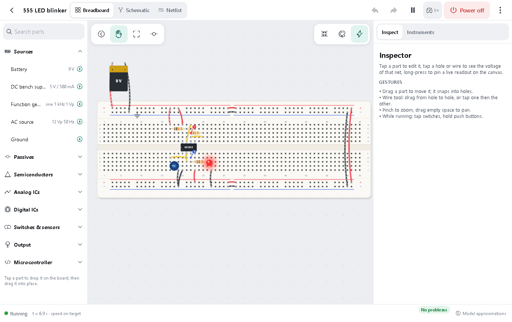

# Bench

An offline electronics lab and teacher for phones and tablets (with a browser build too). You build circuits on a realistic breadboard or a free schematic canvas, then power them on and watch them work. You'll see LEDs light, capacitors charge, scope traces, logic chips counting, and an emulated Arduino running code. There are no accounts, no backend, no AI features and no analytics.



## Run it

```bash
npm install            # also copies CanvasKit for the web build (postinstall)
npx expo start         # press a (Android), i (iOS) or w (web)
```

Every native module Bench uses (Skia, Reanimated, Gesture Handler, SQLite, file system, sharing, document picker) ships in Expo Go for SDK 58. You can also make a development build with `npx expo run:android` or `bunx`/`npx eas-cli build --profile development`.

Quality gates:

```bash
npm test               # 127 Jest tests: solver vs analytic answers, AVR, netlists, examples, lessons
npm run typecheck      # app + sim-core, TypeScript strict
npx eslint src sim-core/src
npx expo-doctor
```

## What's inside

| Area | Where |
|---|---|
| Circuit solver (pure TS, no React) | `sim-core/` (MNA, Newton–Raphson, DC / transient / AC, device models, logic chips, AVR co-simulation, AVR assembler) |
| Breadboard geometry, parts catalogue, netlist extraction, examples, lessons, glossary | `src/model/` |
| Simulation runtime (frame-budgeted loop, snapshots, instruments) | `src/sim/` |
| Skia canvas: breadboard, parts, wires, current flow, schematic symbols, gestures | `src/canvas/` |
| Workbench, inspector, instruments, parts tray | `src/components/` |
| Screens (Expo Router) | `src/app/` |

- Architecture and the ngspice decision: [`docs/ARCHITECTURE.md`](docs/ARCHITECTURE.md)
- Status, test list and every model simplification: [`docs/STATUS.md`](docs/STATUS.md)
- Screenshots: [`docs/screenshots/`](docs/screenshots)

## Arduino: how compilation works

Bench runs real ATmega328P machine code in avr8js, but it **cannot compile C++ on the device**, because that needs avr-gcc. The six starter programs are hand-written AVR assembly equivalents of the classic sketches, and Bench assembles them on the device. You can edit and re-assemble them. To run your own C++, export a `.hex` from the Arduino IDE (Sketch → Export Compiled Binary) and import it, or paste its text.

## Disclaimer

Bench is a learning simulator. Its results come from simplified device models and may differ from real components.
